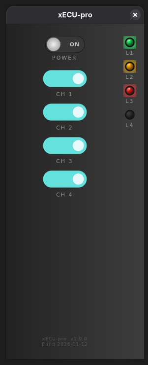

# xECU-pro

---

## Preview

<table>
<tr>
<td valign="top" width="60%">

A compact, dark-themed desktop control panel built with Qt6. Designed for embedded and ECU test environments where you need a clean, hardware-feel interface to monitor channel states and drive outputs from a PC.

**Features:**
- **Power flip switch** — animated side-to-side toggle with ON/OFF labels
- **4 channel bat switches** — image-based toggle switches with per-channel labels
- **4 LED indicators** — L1–L4 with full glow rendering in green, amber, and red
- **Dark gradient UI** — no-chrome window with a brushed steel aesthetic
- Smooth switch animations with 150 ms easing
- CAN bus integration — LEDs driven by register writes, switch states broadcast on change

</td>
<td valign="top" width="40%">



</td>
</tr>
</table>

---

## Requirements

- Qt 6.4 or later (Qml, Quick for master-control-module; Widgets for SimFy; WaylandCompositor for compositor)
- CMake 3.20+
- C++17
- Linux kernel with SocketCAN (`vcan` module)

---

## Build project

```bash
cmake -S . -B build
cmake --build build
```

## Run

```bash
./build/apps/compositor/compositor                        # both apps side by side in one window
./build/apps/master-control-module/master-control-module  # or each app on its own
./build/apps/SimFy/SimFy
```
---

## Build documentation

```bash
cmake --build build --target docs
```

---

## Code formatting

Code style is defined in [`.clang-format`](.clang-format) (WebKit/Qt-based, 4-space indent, 100 columns).

```bash
cmake --build build --target format         # reformat all sources in place
cmake --build build --target format-check   # check only; fails if anything is unformatted
```

In the dev container, VS Code formats C/C++ files on save. [`.editorconfig`](.editorconfig) sets basic
whitespace rules (spaces, LF line endings, final newline) for all other files.

---

## CAN Protocol

All communication uses a simple register-based protocol over SocketCAN.

### CAN IDs

| CAN ID  | Direction      | Purpose                        |
|---------|----------------|--------------------------------|
| `0x100` | host → xECU    | Write register                 |
| `0x101` | host → xECU    | Read register request          |
| `0x102` | xECU → host    | Read register response         |
| `0x200` | xECU → host    | Switch state broadcast         |

### Message Format

**Write register (`0x100`):**
```
Byte 0 — register address
Byte 1 — value
```

**Read request (`0x101`):**
```
Byte 0 — register address
```

**Read response (`0x102`):**
```
Byte 0 — register address
Byte 1 — value
```

**Switch broadcast (`0x200`):**
```
Byte 0 — register address (0x10–0x14)
Byte 1 — new value (0=Off, 1=On)
```

### Register Map

| Register | Description          | Access | Values                              |
|----------|----------------------|--------|-------------------------------------|
| `0x00`   | LED L1 color         | R/W    | 0=Off  1=Green  2=Amber  3=Red      |
| `0x01`   | LED L2 color         | R/W    | 0=Off  1=Green  2=Amber  3=Red      |
| `0x02`   | LED L3 color         | R/W    | 0=Off  1=Green  2=Amber  3=Red      |
| `0x03`   | LED L4 color         | R/W    | 0=Off  1=Green  2=Amber  3=Red      |
| `0x10`   | Power switch state   | R      | 0=Off  1=On                         |
| `0x11`   | CH1 switch state     | R      | 0=Off  1=On                         |
| `0x12`   | CH2 switch state     | R      | 0=Off  1=On                         |
| `0x13`   | CH3 switch state     | R      | 0=Off  1=On                         |
| `0x14`   | CH4 switch state     | R      | 0=Off  1=On                         |

---

## Virtual CAN Setup (host)

Run once after boot:

```bash
sudo modprobe vcan
sudo ip link add dev vcan0 type vcan
sudo ip link set up vcan0
```

---

## Host Commands

### Monitor all CAN traffic

```bash
candump vcan0
```

### Set LED colors

```bash
# L1 green
cansend vcan0 100#00.01

# L2 amber
cansend vcan0 100#01.02

# L3 red
cansend vcan0 100#02.03

# L4 off
cansend vcan0 100#03.00
```

### Turn all LEDs off

```bash
cansend vcan0 100#00.00
cansend vcan0 100#01.00
cansend vcan0 100#02.00
cansend vcan0 100#03.00
```

### Read LED state

```bash
# Request L1 color — response arrives on 0x102
cansend vcan0 101#00
```

### Read switch states

```bash
# Power switch
cansend vcan0 101#10

# CH1
cansend vcan0 101#11

# CH2
cansend vcan0 101#12

# CH3
cansend vcan0 101#13

# CH4
cansend vcan0 101#14
```

Watch the response in a second terminal:

```bash
candump vcan0 | grep " 102"
```

### Simulate a switch broadcast (for testing)

```bash
# Simulate power switch turned on
cansend vcan0 200#10.01

# Simulate CH3 turned off
cansend vcan0 200#13.00
```

---

## Project Structure

```
apps/master-control-module/
├── CMakeLists.txt
├── include/
│   ├── CanBus.h               — SocketCAN integration (QSocketNotifier)
│   ├── ControlPanel.h         — controller exposed to QML (owns CanBus + RegisterMap)
│   ├── Protocol.h             — CAN IDs and register addresses
│   └── RegisterMap.h          — virtual register map
├── src/                       — implementations + main.cpp
├── qml/
│   └── Main.qml               — control panel window
├── ui/                        — QML module EvH.MasterControl.UI
│   ├── FlipSwitch.qml         — animated horizontal flip switch
│   ├── ImageToggleSwitch.qml  — PNG-based bat switch
│   └── LedIndicator.qml       — glowing LED bulb
└── assets/                    — switch images
```

See [apps/master-control-module/docs/architecture.md](apps/master-control-module/docs/architecture.md) for the design.

---

## License

MIT
